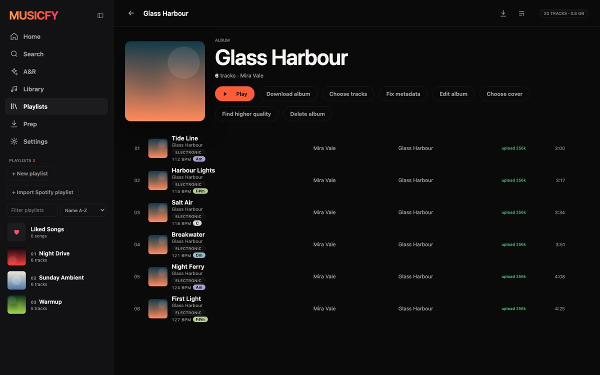

# MUSICFY

Self-hosted music library with a browser player, a DJ prep bench, and a library you own.
One Node service, one SQLite database, no npm dependencies, no account in the playback path.

> **Status: in development (pre-1.0).** Interfaces, settings and the database schema can
> change between releases. Try it on a copy of a library before depending on it in a shop.
> `musicfy version` prints the build you are running.

Runs on 64-bit Linux and macOS. Windows works through Docker Desktop or WSL2. See **Which computers it runs on** below.

**Jump to:** [Install](#install) · [Which computers](#which-computers-it-runs-on) · [Screenshots](#a-look) · [What it does](#what-it-does) · [Requirements](#requirements) · [License](#license)

## Install

The server install needs a terminal and about 10 minutes. On a Mac, the app below needs
neither. MUSICFY runs on your computer; you use it in a browser. You do not need an account
or a cloud service to run it; an OpenAI-compatible model endpoint is optional and only A&R
uses it (see [Language model](#language-model-optional)).
A VPS or home server is a computer
too: install it the same way, keep it on `127.0.0.1`, and reach it through SSH or a VPN.

### macOS app (no terminal)

On a Mac, skip the terminal: download the DMG from
[Releases](https://github.com/theh4v0c/musicfy/releases/latest), open it and drag **MUSICFY**
into Applications. The build is Apple Silicon (M1 and later); an Intel Mac still uses the
server install below. The app is the same engine and the same interface, with ffmpeg,
ffprobe and yt-dlp inside it:

- data lives in `~/Library/Application Support/MUSICFY`, downloads in `~/Music/MUSICFY`;
- the first run is five short screens (name, city, mode, folder), and every one can be skipped;
- **File → Add music folder…** (⌘O) imports a library in place — nothing is copied;
- no account, no service, no Node install, and nothing is uploaded;
- macOS blocks any app that is not notarized, so the first launch needs **System Settings →
  Privacy & Security → Open Anyway**.

BPM and key analysis needs the Python analyser, which the app does not bundle. Everything
else — library, playback, search, downloads, playlists, DJ export — works out of the box.
The server install below is for Linux, for an always-on machine, and for a Mac you want to
reach from other devices.

### macOS

1. Open **Terminal**: press `Command + Space`, type `Terminal`, press Enter.

2. Install the helper programs. If `brew` is not installed, see
   [INSTALL.md section 3.2](INSTALL.md#32-install-the-helper-programs) first.

   ```sh
   brew install node ffmpeg python git
   ```

3. Install MUSICFY. Copy this whole line, paste it, press Enter, and wait 5 to 10 minutes:

   ```sh
   curl -fsSL https://raw.githubusercontent.com/theh4v0c/musicfy/main/install.sh | sh
   ```

   It creates `~/.musicfy`, installs the two Python environments, and puts the `musicfy`
   command in `~/.local/bin`. You should see `MUSICFY is at http://localhost:8710`.

4. Start it:

   ```sh
   musicfy start
   ```

5. Open <http://localhost:8710> in your browser.

If step 4 says `musicfy: command not found`, close Terminal, open it again, and run
`musicfy start`. If it still fails, run `export PATH="$HOME/.local/bin:$PATH"` and try
again.

### Linux (Debian, Ubuntu, Mint, Pop!_OS)

1. Open **Terminal**: press `Control + Alt + T`.

2. Install the helper programs. Copy this whole block, paste it, press Enter:

   ```sh
   sudo apt update
   sudo apt install -y curl git ffmpeg python3 python3-venv
   curl -fsSL https://deb.nodesource.com/setup_22.x | sudo -E bash -
   sudo apt install -y nodejs
   ```

   `sudo` asks for your login password. You will not see dots while typing.

3. Install MUSICFY. Copy this whole line, paste it, press Enter, and wait 5 to 10 minutes:

   ```sh
   curl -fsSL https://raw.githubusercontent.com/theh4v0c/musicfy/main/install.sh | sh
   ```

   You should see `MUSICFY is at http://localhost:8710`.

4. Start it:

   ```sh
   musicfy start
   ```

5. Open <http://localhost:8710> in your browser.

If step 4 says `musicfy: command not found`, close the terminal, open it again, and run
`musicfy start`.

**Fedora or Arch:** see [INSTALL.md section 4.2](INSTALL.md#42-install-the-helper-programs)
for the package names.

### Windows

Native Windows is not supported. Use **Docker Desktop** or **WSL2** and follow the
step-by-step guide: [Windows instructions in INSTALL.md](INSTALL.md#5-windows).

### Install with an agent

If you use an open-source terminal coding agent such as **OpenCode** or **Hermes**, give it
the copy-paste prompt in [AGENT_INSTALL.md](AGENT_INSTALL.md). It checks the machine,
installs MUSICFY on localhost, and verifies it without opening a network port.

### Full instructions

The short version above is enough for most people. If you want every click and every
command explained, or something did not work, read [INSTALL.md](INSTALL.md). It starts
from "open the terminal", explains the words, and includes what to do when a command
fails.

## Which computers it runs on

| Computer | How it runs | Status |
|---|---|---|
| **macOS** 13 or newer, Apple Silicon or Intel | `install.sh`, or Docker | supported |
| **Linux** 64-bit, Debian/Ubuntu and similar | `install.sh`, systemd or the `musicfy` command | supported and tested on Debian/Ubuntu |
| **Windows 10/11** | Docker Desktop, or WSL2 with Ubuntu and then the Linux steps | supported through Linux; native Windows is not supported |
| **NAS / home server** | Docker, 64-bit amd64 or arm64 | supported when the NAS can run Linux containers |
| **VPS / cloud server** | the Linux steps on the server; keep the bind on `127.0.0.1`, run `musicfy netcheck`, then use a domain ([DOMAIN.md](DOMAIN.md)) or an SSH tunnel | supported; do not expose 8710 directly |
| **Phone or tablet** | no; it is a browser client for the computer above | use the browser |

You need Node 22.13 or newer, Python 3.10 or newer, `ffmpeg`, `ffprobe` and `yt-dlp`.
`install.sh` and `musicfy setup` install and check what they can; `musicfy doctor` tells
you what is still missing. A 64-bit machine is required.

After installing, run `musicfy netcheck` once. It checks whether YouTube accepts this
address, whether SoundCloud answers, and whether IPv4 is the faster route, then sets the
download settings that fit (`musicfy netcheck --apply`). On a rented server this is the
difference between a working download queue and a wall of `429` and bot-check failures.

## A look

Screenshots use a small demo library, not a real one.

| Library | Prep |
|---|---|
|  |  |

| Album | Playlist on a phone |
|---|---|
|  |  |

## What it does

- **Library** of tracks, albums, artists and playlists in `node:sqlite`.
- **Two surfaces, one app**: the first run asks DJ or Listener; Settings changes it later,
  and the choice is stored on the server.
- **Adopt a folder you already have**: point at it, or at one playlist file, and the audio is
  registered in place with no copy. Traktor NML, rekordbox XML, M3U and PLS playlists come in
  with their order, and the BPM and key those files already carry are kept.
- **One track, many sources.** A track row is metadata plus a ladder: owned file first, then
  free web sources, resolved on demand and verified against the catalogue before playing.
- **Search** that resolves what a track actually is (canonical artist, title, length) and shows
  the catalogue before any web scraping. One scoped field (Both / library / web) and playlist
  hits; a command palette (`⌘K`) for views, tracks, playlists and actions.
- **Downloads** with a queue, retries, client fallbacks, and truncation guards so a 30 second
  preview never replaces a real track. Partial albums are completed from the real tracklist.
- **Analysis** of BPM, key, loudness and energy with librosa, self-running in the background.
- **DJ prep**: harmonic ordering, Camelot keys, and exports for Rekordbox (XML), Traktor (NML),
  a CDJ USB folder, plus a ZIP with the audio for moving a set to another machine.
- **Genre** from the catalogue plus MusicBrainz artist tags.
- **Kids mode**: mark playlists for a kid or a teenager, lock the exit with a PIN, and their
  plays are recorded apart — your taste, rotation, history and A&R never see them.
- **Listening history** capture, and a weekly "For you" playlist built from what is played now.
- **Guided Ask**: plain language queries, playlist building and album downloads are
  proposals first; nothing is created or queued until you confirm.
- **Mood and style crates**: local-first selection scored by your plays, likes and
  playlists, with presets for dance, house, techno, indie dance, downtempo and Burning
  Man, plus a reference artist ("like Burial").
- **Offline** playback on a phone through a service worker, once served over HTTPS.
- **English and Portuguese (Brazil)** interface, chosen in Settings or from the browser.
  Track, artist and album names are never translated.
- **Listener and DJ modes.** Listener hides Prep, harmonic tools, BPM/key chips and DJ
  exports. A&R, search, playlists and the model endpoint stay. DJ shows the full bench.
  The mode is in Settings → Mode.

## Language model (optional)

MUSICFY does not need one. Playback, playlists, downloads, covers, metadata, Prep, exports and
statistics never call a model. A&R is the only feature that can use one, and it works without
it.

| With an OpenAI-compatible endpoint | Without one |
|---|---|
| Free-form briefs: "a playlist for a 7 year old who loves dinosaurs", "something darker than the last set", Portuguese that is not a command | Explicit requests: counts, genre or family, key, BPM range, year, play count, "never played", "not downloaded", "by X", "based on X", albums, downloads |
| The model reads the sentence and returns `{intent,args}`; the server does the search, never the model | The built-in rules read the sentence directly: no network call, faster and deterministic |
| Configure it in Settings -> Model endpoint; **Test connection** shows the state. `http://` is accepted only for a model on localhost or the LAN; a remote one must be `https://` | A&R still answers; it will not invent themes for an occasion or follow a vague mood |

The model sees the sentence and nothing else: not the library, not the files, not the
history. If it times out (45 s), returns unusable JSON, or is not configured, A&R falls back
to the rules and labels the answer `local` instead of `model`.

Catalogue metadata comes from free public APIs (the iTunes storefront and Deezer); audio
comes from yt-dlp and SoundCloud; none of that needs an account. A YouTube `cookies.txt` is
optional and only for addresses YouTube blocks.

See `DOCS.md` ("Language model: with and without") for the exact contract.

## Layout

```
core/            Node service, no dependencies
  core.js        HTTP server, routes, library, downloads, streaming
  query.js       plain language to SQL
  agent.js       intents: search, build playlist, download album, download missing
  recommend.js   weekly picks from current listening
  identity.js    catalogue identity (iTunes), cached
  genre.js       artist tags (MusicBrainz)
  mb.js          ISRC and duration from MusicBrainz
  llm.js         optional model endpoint
  ytdlp.js       YouTube and SoundCloud resolution
  export.js      rekordbox / Traktor / CDJ exports
  tagwrite.js    Traktor PRIV + standard ID3 writer
  analyze.py     librosa analysis worker
web/             vanilla JS single page app
  app.js         views, playback, queue, context menus
  app.css        styling, mobile layout
  index.html     shell; the ?v= number busts asset cache
  sw.js          service worker for offline shell and audio
bin/smoke.sh     endpoint health checks
bin/test.mjs     API assertions (playlists, resolver, search cache, guards, intents)
DOCS.md          data model, endpoints, rungs, incident log
OPERATIONS.md    deploy, backup, restore, diagnose (generic)
```

## YouTube and servers

On a home connection YouTube serves the audio. On a **rented server** the same request can
be answered with `Sign in to confirm you're not a bot`: search and metadata still work, the
audio download needs a session. That is YouTube's decision about the address, not a MUSICFY
setting.

Free ways through it:

- **Cookies from your own YouTube session.** Export `cookies.txt` from a logged-in browser,
  put it on the server, set `MUSICFY_YTDLP_COOKIES=/path/cookies.txt`. This is the reliable
  one. See `INSTALL.md`.
- **Download at home and upload.** A home address is not challenged; the file lands owned.
- **Let SoundCloud answer.** MUSICFY already tries it first on a server, and a challenged
  YouTube job is retried later instead of being marked broken.

A VPN is not required, and no paid service is involved.

## Requirements

- Node 22.13 or newer (`node:sqlite` is unflagged there, and there are no npm dependencies).
- `yt-dlp` and `ffmpeg`/`ffprobe` for downloads and streaming.
- Python 3 with librosa for analysis (see `INSTALL.md`).

Every path comes from the environment (`MUSICFY_HOME`, `MUSICFY_OWNED`, `MUSICFY_PYTHON`,
…); `/opt/musicfy` is only this machine's default. See `INSTALL.md` for the table.

## Development

```sh
node core/core.js          # listens on 0.0.0.0:8710
./bin/smoke.sh             # checks every critical endpoint
node bin/test.mjs          # asserts real behaviour, 61 checks
```

Settings and secrets (`settings.json`, `llm.json`, `soundcloud.json`) live in the data
directory and are never committed.

## Put it on a domain

For a shop, studio or family install that should be reachable over HTTPS with a login, see
[DOMAIN.md](DOMAIN.md): DNS record, firewall, Caddy certificate, the shared password, the
Listener mode and what to check when it does not load. It uses Caddy as the only public
service and keeps MUSICFY on `127.0.0.1`.

## Deploy notes

- Serve it behind HTTPS. The service worker, and therefore offline playback, requires a
  secure context; plain LAN HTTP cannot register it.
- Audio uses range requests, so a reverse proxy must pass `Range` and `206` through.
- The installer binds to `127.0.0.1`. For a trusted LAN, `--bind=0.0.0.0` plus a token is
  supported. Do not expose 8710 directly to the public internet; use a VPN or an
  authenticated HTTPS proxy. The app also checks the Origin header on state-changing
  requests.

## Design rules

1. Metadata may come from anywhere. Playback never goes through a paid service.
2. No paid APIs, subscriptions or registrations are required. Optional and never required:
   a model endpoint you run yourself (or a free one) for A&R, and a cookies file from your
   own YouTube session for a server address YouTube blocks.
3. Back up source and database before changing code.
4. Keep the interface plain: no emojis, no em dashes, no marketing copy.

See `DOCS.md` for the data model and every endpoint, and `OPERATIONS.md` for the runbook.

## License

MUSICFY is licensed under **AGPL-3.0-or-later**. The full text is in `LICENSE`; the SPDX
identifier is in `package.json`. In plain terms: you can run, study, change and share it,
and if you run a modified version as a network service, your users must be able to get
the corresponding source.

This is a code license, not a music license. MUSICFY ships no audio and grants no rights
to anything you download, stream or add to your library. You are responsible for the
material you add and for how you obtain it; downloading from YouTube, SoundCloud or any
other service is governed by that service's terms and by your local copyright law.
MUSICFY is not affiliated with those services, with Pioneer, Rekordbox, Traktor, Spotify,
Apple, Deezer or MusicBrainz.

Third-party tools keep their own licenses: ffmpeg/ffprobe (LGPL/GPL depending on the
build), yt-dlp (Unlicense), Node (MIT), Python and the librosa stack (BSD/ISC family).
The Docker image installs ffmpeg from Debian and carries its copyright file; see
`THIRD_PARTY.md`.

Contributions are accepted under the same license, with a DCO sign-off; see
`CONTRIBUTING.md`. This section is engineering guidance, not legal advice.
