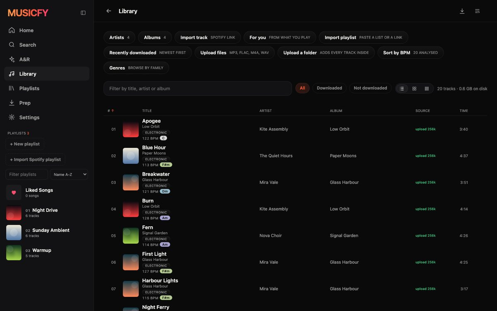
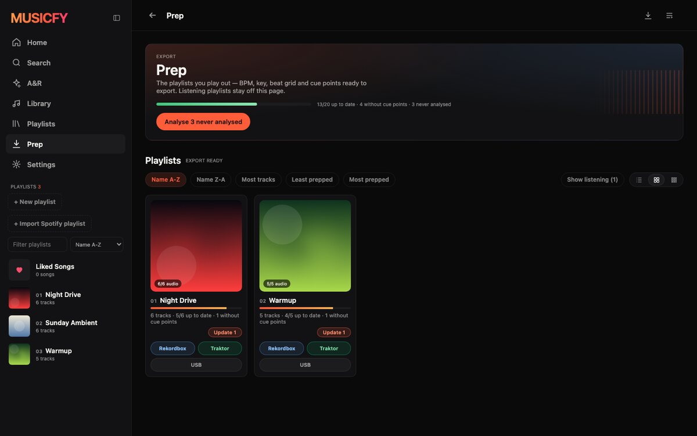
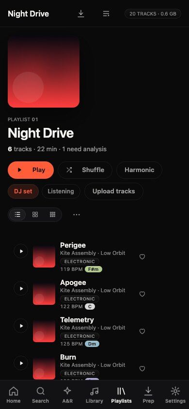

# MUSICFY

Self-hosted music library with a browser player, a DJ prep bench, and a library you own.
One Node service, one SQLite database, no npm dependencies, no account in the playback path.

Runs on 64-bit Linux and macOS. Windows works through Docker Desktop or WSL2. See **Which computers it runs on** below.

**Jump to:** [Install](#install) · [Which computers](#which-computers-it-runs-on) · [Screenshots](#a-look) · [What it does](#what-it-does) · [Requirements](#requirements) · [License](#license)

## Install

You need a terminal and about 10 minutes. MUSICFY runs on your computer; you use it in a
browser. You do not need an account, a cloud service or a second computer.

### macOS

1. Open **Terminal**: press `Command + Space`, type `Terminal`, press Enter.

2. Install the helper programs. If `brew` is not installed, see
   [INSTALL.md section 3.2](INSTALL.md#32-install-the-helper-programs) first.

   ```sh
   brew install node ffmpeg python git
   ```

3. Install MUSICFY. Copy this whole line, paste it, press Enter, and wait 5 to 10 minutes:

   ```sh
   curl -fsSL https://raw.githubusercontent.com/theh4v0c/musicfy/main/install.sh | sh
   ```

   It creates `~/.musicfy`, installs the two Python environments, and puts the `musicfy`
   command in `~/.local/bin`. You should see `MUSICFY is at http://localhost:8710`.

4. Start it:

   ```sh
   musicfy start
   ```

5. Open <http://localhost:8710> in your browser.

If step 4 says `musicfy: command not found`, close Terminal, open it again, and run
`musicfy start`. If it still fails, run `export PATH="$HOME/.local/bin:$PATH"` and try
again.

### Linux (Debian, Ubuntu, Mint, Pop!_OS)

1. Open **Terminal**: press `Control + Alt + T`.

2. Install the helper programs. Copy this whole block, paste it, press Enter:

   ```sh
   sudo apt update
   sudo apt install -y curl git ffmpeg python3 python3-venv
   curl -fsSL https://deb.nodesource.com/setup_22.x | sudo -E bash -
   sudo apt install -y nodejs
   ```

   `sudo` asks for your login password. You will not see dots while typing.

3. Install MUSICFY. Copy this whole line, paste it, press Enter, and wait 5 to 10 minutes:

   ```sh
   curl -fsSL https://raw.githubusercontent.com/theh4v0c/musicfy/main/install.sh | sh
   ```

   You should see `MUSICFY is at http://localhost:8710`.

4. Start it:

   ```sh
   musicfy start
   ```

5. Open <http://localhost:8710> in your browser.

If step 4 says `musicfy: command not found`, close the terminal, open it again, and run
`musicfy start`.

**Fedora or Arch:** see [INSTALL.md section 4.2](INSTALL.md#42-install-the-helper-programs)
for the package names.

### Windows

Native Windows is not supported. Use **Docker Desktop** or **WSL2** and follow the
step-by-step guide: [Windows instructions in INSTALL.md](INSTALL.md#5-windows).

### Install with an agent

If you use an open-source terminal coding agent such as **OpenCode** or **Hermes**, give it
the copy-paste prompt in [AGENT_INSTALL.md](AGENT_INSTALL.md). It checks the machine,
installs MUSICFY on localhost, and verifies it without opening a network port.

### Full instructions

The short version above is enough for most people. If you want every click and every
command explained, or something did not work, read [INSTALL.md](INSTALL.md). It starts
from "open the terminal", explains the words, and includes what to do when a command
fails.

## Which computers it runs on

| Computer | How it runs | Status |
|---|---|---|
| **macOS** 13 or newer, Apple Silicon or Intel | `install.sh`, or Docker | supported |
| **Linux** 64-bit, Debian/Ubuntu and similar | `install.sh`, systemd or the `musicfy` command | supported and tested on Debian/Ubuntu |
| **Windows 10/11** | Docker Desktop, or WSL2 with Ubuntu and then the Linux steps | supported through Linux; native Windows is not supported |
| **NAS / home server** | Docker, 64-bit amd64 or arm64 | supported when the NAS can run Linux containers |
| **Phone or tablet** | no; it is a browser client for the computer above | use the browser |

You need Node 22.13 or newer, Python 3.10 or newer, `ffmpeg`, `ffprobe` and `yt-dlp`.
`install.sh` and `musicfy setup` install and check what they can; `musicfy doctor` tells
you what is still missing. A 64-bit machine is required.

## A look

Screenshots use a small demo library, not a real one.

| Library | Prep |
|---|---|
|  |  |

| Album | Playlist on a phone |
|---|---|
|  |  |

## What it does

- **Library** of tracks, albums, artists and playlists in `node:sqlite`.
- **One track, many sources.** A track row is metadata plus a ladder: owned file first, then
  free web sources, resolved on demand and verified against the catalogue before playing.
- **Search** that resolves what a track actually is (canonical artist, title, length) and shows
  the catalogue before any web scraping.
- **Downloads** with a queue, retries, client fallbacks, and truncation guards so a 30 second
  preview never replaces a real track. Partial albums are completed from the real tracklist.
- **Analysis** of BPM, key, loudness and energy with librosa, self-running in the background.
- **DJ prep**: harmonic ordering, Camelot keys, and exports for Rekordbox (XML), Traktor (NML),
  a CDJ USB folder, plus a ZIP with the audio for moving a set to another machine.
- **Genre** from the catalogue plus MusicBrainz artist tags.
- **Listening history** capture, and a weekly "For you" playlist built from what is played now.
- **Guided Ask**: plain language queries, playlist building and album downloads are
  proposals first; nothing is created or queued until you confirm.
- **Mood and style crates**: local-first selection scored by your plays, likes and
  playlists, with presets for dance, house, techno, indie dance, downtempo and Burning
  Man, plus a reference artist ("like Burial").
- **Offline** playback on a phone through a service worker, once served over HTTPS.

## Layout

```
core/            Node service, no dependencies
  core.js        HTTP server, routes, library, downloads, streaming
  query.js       plain language to SQL
  agent.js       intents: search, build playlist, download album, download missing
  recommend.js   weekly picks from current listening
  identity.js    catalogue identity (iTunes), cached
  genre.js       artist tags (MusicBrainz)
  mb.js          ISRC and duration from MusicBrainz
  llm.js         optional model endpoint
  ytdlp.js       YouTube and SoundCloud resolution
  export.js      rekordbox / Traktor / CDJ exports
  tagwrite.js    Traktor PRIV + standard ID3 writer
  analyze.py     librosa analysis worker
web/             vanilla JS single page app
  app.js         views, playback, queue, context menus
  app.css        styling, mobile layout
  index.html     shell; the ?v= number busts asset cache
  sw.js          service worker for offline shell and audio
bin/smoke.sh     endpoint health checks
bin/test.mjs     API assertions (playlists, resolver, search cache, guards, intents)
DOCS.md          data model, endpoints, rungs, incident log
OPERATIONS.md    deploy, backup, restore, diagnose (generic)
```

## Requirements

- Node 22.13 or newer (`node:sqlite` is unflagged there, and there are no npm dependencies).
- `yt-dlp` and `ffmpeg`/`ffprobe` for downloads and streaming.
- Python 3 with librosa for analysis (see `INSTALL.md`).

Every path comes from the environment (`MUSICFY_HOME`, `MUSICFY_OWNED`, `MUSICFY_PYTHON`,
…); `/opt/musicfy` is only this machine's default. See `INSTALL.md` for the table.

## Development

```sh
node core/core.js          # listens on 0.0.0.0:8710
./bin/smoke.sh             # checks every critical endpoint
node bin/test.mjs          # asserts real behaviour, 61 checks
```

Settings and secrets (`settings.json`, `llm.json`, `soundcloud.json`) live in the data
directory and are never committed.

## Deploy notes

- Serve it behind HTTPS. The service worker, and therefore offline playback, requires a
  secure context; plain LAN HTTP cannot register it.
- Audio uses range requests, so a reverse proxy must pass `Range` and `206` through.
- Set `MUSICFY_TOKEN` to add a shared-secret gate; the app also checks the Origin header on
  state-changing requests.

## Design rules

1. Metadata may come from anywhere. Playback never goes through a paid service.
2. No paid APIs, no subscriptions, no registrations that can expire.
3. Back up source and database before changing code.
4. Keep the interface plain: no emojis, no em dashes, no marketing copy.

See `DOCS.md` for the data model and every endpoint, and `OPERATIONS.md` for the runbook.

## License

MUSICFY is licensed under **AGPL-3.0-or-later**. The full text is in `LICENSE`; the SPDX
identifier is in `package.json`. In plain terms: you can run, study, change and share it,
and if you run a modified version as a network service, your users must be able to get
the corresponding source.

This is a code license, not a music license. MUSICFY ships no audio and grants no rights
to anything you download, stream or add to your library. You are responsible for the
material you add and for how you obtain it; downloading from YouTube, SoundCloud or any
other service is governed by that service's terms and by your local copyright law.
MUSICFY is not affiliated with those services, with Pioneer, Rekordbox, Traktor, Spotify,
Apple, Deezer or MusicBrainz.

Third-party tools keep their own licenses: ffmpeg/ffprobe (LGPL/GPL depending on the
build), yt-dlp (Unlicense), Node (MIT), Python and the librosa stack (BSD/ISC family).
The Docker image installs ffmpeg from Debian and carries its copyright file; see
`THIRD_PARTY.md`.

Contributions are accepted under the same license, with a DCO sign-off; see
`CONTRIBUTING.md`. This section is engineering guidance, not legal advice.
